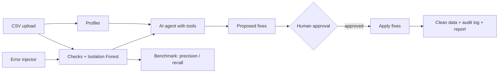

# 🛡️ DataGuard AI

**An AI agent that audits, explains and fixes data quality problems — with human approval and a measured accuracy benchmark.**

🔗 **Live demo:** https://dataguard-ai-arpita.streamlit.app 
👩‍💻 **Author:** Arpita Bhattacharjee, MSc Computer Science, Memorial University of Newfoundland

---

## Why I built this

Small organizations often run on messy spreadsheets: missing values, duplicate rows, prices typed as text, misspelled city names. Bad data leads to wrong reports and wrong decisions.

DataGuard AI finds these problems automatically, explains them in plain English for non-technical staff, and proposes fixes. **Nothing changes without a human's approval**, and every change is recorded.

---

## What it does

| Step | What happens |
|---|---|
| 1. Profile | Summarizes the dataset: size, types, missing values, duplicates, statistics |
| 2. Detect | 7 rule-based checks + machine learning anomaly detection |
| 3. AI agent | An LLM agent uses tools to inspect the issues and proposes fixes from a safe list |
| 4. Approve | A person approves or rejects each fix |
| 5. Apply | Approved fixes are applied; every change goes into an audit log |
| 6. Measure | Quality score before vs after, plus an accuracy benchmark |

### Checks

- Missing values
- Exact duplicate rows
- Wrong data type (e.g. `$4.10` in a number column)
- Outliers (3 × IQR rule)
- Negative values in positive columns
- Inconsistent categories (e.g. `St. John's`, `ST. JOHN'S`, `st. john's`)
- Invalid dates (e.g. `2024-02-31`)
- **Machine learning:** Isolation Forest flags rows that look unusual

### The AI agent

The agent (Google Gemini with function calling) has 4 tools:

- `get_profile()` – understand the dataset
- `get_issue_summary()` – see detected problems
- `get_issue_examples(type)` – look at real values
- `propose_fix(type, column, action, reason)` – suggest one fix from an allow-list

It can only choose from **9 safe actions** (e.g. `drop_duplicate_rows`, `convert_to_number`, `fill_with_median`, `flag_only`), so it cannot invent changes. In a typical audit it made **21 tool calls** and proposed **11 fixes**, each with a reason.

---

## Results

### Benchmark

To prove accuracy, I inject **known errors** into a clean dataset (900 rows of monthly prices for 5 Newfoundland cities) and measure how many the checks find.

| Error type | Injected | Precision | Recall |
|---|---|---|---|
| Missing | 18 | 100% | 100% |
| Wrong type | 18 | 100% | 100% |
| Outlier | 18 | 81.8% | 100% |
| Negative | 18 | 100% | 100% |
| Inconsistent | 18 | 100% | 100% |
| Invalid date | 18 | 100% | 100% |
| Duplicate | 18 | 100% | 100% |
| **Overall** | **126** | **96.9%** | **100%** |

- Isolation Forest flagged **10 rows; all 10 contained real errors**.
- Outlier precision is lower because negative values are also outside the normal range, so they are flagged twice (once as negative, once as outlier).

### Cleaning

On the sample dataset, approved fixes raised the **data quality score from 95.6 to 99.2**, with **108 changes** recorded in the audit log.

---

## Architecture



## Project structure

| File | Purpose |
|---|---|
| `app.py` | Streamlit dashboard (5 tabs) |
| `profiler.py` | Dataset summary |
| `checks.py` | Rule-based checks + Isolation Forest |
| `agent.py` | LLM agent with tool calling |
| `fixes.py` | Applies approved fixes, audit log, quality score |
| `injector.py` | Creates clean data and injects known errors |
| `benchmark.py` | Precision / recall evaluation |
| `demo_run.json` | Saved agent run, used when the free AI quota is used up |

---

## Design decisions

- **Allow-list of actions:** the agent proposes, a person decides. This keeps the AI safe and predictable.
- **Audit log:** every change shows the row, column, before and after values.
- **Measured, not assumed:** the benchmark gives real numbers instead of "it seems to work".
- **Reliable demo:** if the free AI quota runs out, the app shows a saved agent run instead of failing.

## Limitations and next steps

- The benchmark uses **synthetic errors**, which are easier to catch than real ones. Next: a "hard mode" with subtle errors (e.g. price × 1.5) to find where detection fails.
- Outlier detection uses one rule for the whole column. Next: detect outliers **per product** for better precision.
- Next: test on a real public dataset (e.g. Statistics Canada).

---

## Run it locally

```bash
git clone https://github.com/ArpitaBhattacharjee/dataguard-ai.git
cd dataguard-ai
python3 -m venv venv && source venv/bin/activate
pip install -r requirements.txt
echo "GEMINI_API_KEY=your_key_here" > key.env
streamlit run app.py
```

Get a free Gemini API key at [aistudio.google.com](https://aistudio.google.com/apikey).

## Tech stack

Python · Pandas · NumPy · scikit-learn · Google Gemini API · Streamlit · Plotly
